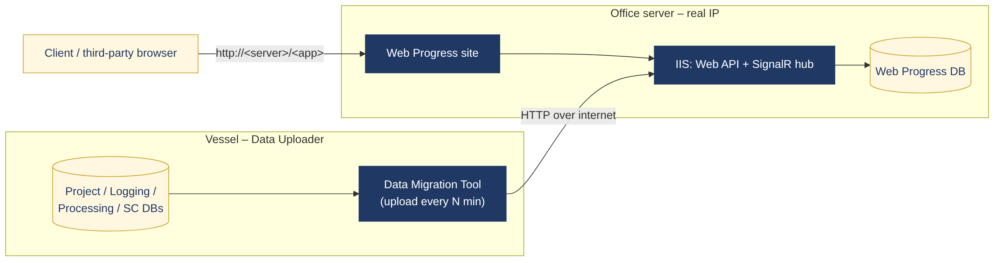
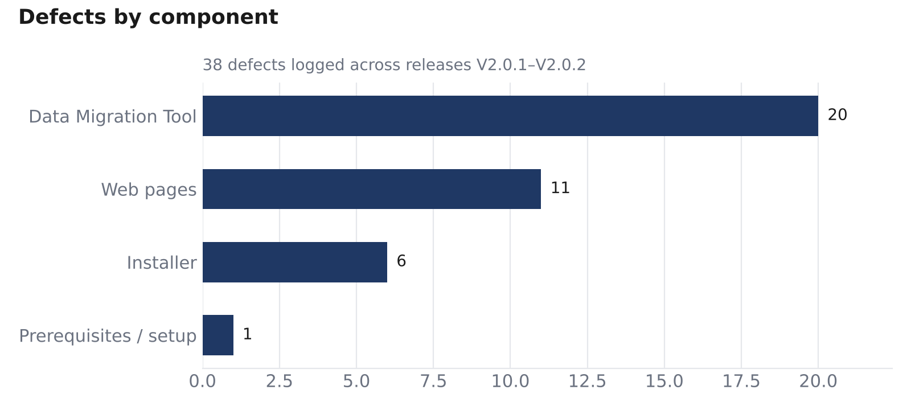
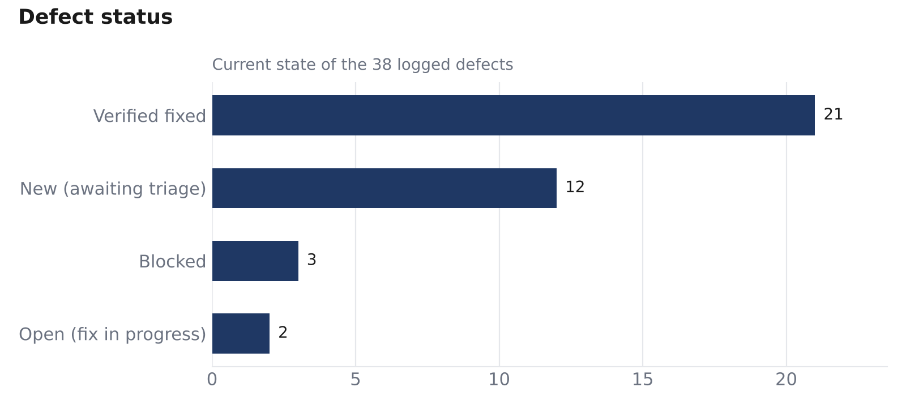

# Web Progress — QA Case Study

**Role:** SQA Engineer · **Company:** MCS Technical Support, Egypt · **Period:** 2026 · **Releases covered:** V2.0.1 → V2.0.2 → V2.0.3 (in progress)

> Web Progress is a web application that shows offshore pipeline and structure inspection progress in near real time. A desktop **Data Migration Tool** on the vessel uploads survey data to an **IIS-hosted web site** in the office, which clients and project managers open from anywhere.
>
> *All material here is sanitized: client names, credentials, server addresses and internal document IDs have been removed. It is published only to show my QA work.*

---

## At a glance

| | |
|---|---|
| **Defects logged** | 38, each with reproducible steps, expected behaviour, priority and severity |
| **Verified fixed** | 21, all re-tested and closed by QA |
| **Test cases designed** | 112: 12 smoke, 79 functional, 21 regression |
| **Requirements analysed** | 6 new/enhancement items (WP-01 … WP-06), each with acceptance tests |
| **Traceability** | 100 %. Every defect and requirement maps to at least one test case |
| **Test configurations** | 14 scenarios across 2 deployment modes × 3 scopes × migration settings × 1–2 vessels |

---

## What made this system hard to test

- **Distributed deployment.** It runs either on one machine ("On Deck") or across three: vessel uploader, office server with a public IP, and a remote viewer. Several defects only appeared in the multi-machine setup.
- **Data correctness, not just UI.** Progress percentages, KP coverage and event counts come from survey databases. A wrong number tells a client a pipeline is finished when it isn't. I checked dashboard values against SQL queries on the source data.
- **Heavy environment setup.** The system needs IIS features, URL Rewrite, .NET 3.5/4.8, SQL Server restores and licence setup. Installer and setup issues made up 7 of the 38 defects.
- **Long-running background process.** The uploader runs on a timer, so I tested repeated cycles, network loss, a server going down mid-upload, and editing the source DB during migration.

## My approach

1. **Learned the system from the manual and the deployments.** I mapped the installer options, Data Migration settings and every page of the site.
2. **Exploratory testing of the first releases (V2.0.1–V2.0.2).** I logged defects in a structured tracker with a dashboard and release log.
3. **Formal test design** using ISTQB techniques:
   - *Equivalence partitioning and boundary values*: upload interval (`00:00`, `00:05`, `25:99`), KP and pipe-count fields, report file size.
   - *Decision tables / combinations*: deployment mode × scope × KP unit × events source → the [scenario matrix](docs/02-test-environment.md#scenario-matrix).
   - *Error guessing*: overlapping primary keys across vessels, a deleted profile file, network drop mid-cycle.
   - *Risk-based priority*: data-correctness and install-blocking paths are High.
4. **A regression suite built from the defect history.** Every fixed bug became a regression case, using the reproduction steps from the tracker.
5. **Requirements review.** I turned management requests into testable requirements with acceptance criteria before development started.

## Deliverables

| Document | What it shows |
|---|---|
| [Test Plan](docs/01-test-plan.md) | Scope, strategy, entry/exit criteria, risks |
| [Test Environment & Scenarios](docs/02-test-environment.md) | Machine roles, prerequisites, architecture, 14-scenario matrix |
| [Requirements Analysis](docs/03-requirements-analysis.md) | WP-01 … WP-06 with acceptance criteria and linked tests |
| [Defect Report](docs/04-defect-report.md) | Metrics, release history and 8 showcase bug reports |
| [Test Suite (Excel)](test-cases/WebProgress_QA_Test_Suite.xlsx) · [PDF](test-cases/WebProgress_QA_Test_Suite.pdf) | 112 test cases, traceability matrix, live execution summary |
| [Bug Tracker (Excel)](bug-reports/WebProgress_Bug_Tracker.xlsx) · [PDF](bug-reports/WebProgress_Bug_Tracker.pdf) | All 38 defects with dashboard and release log |
| [Requirements (Excel)](requirements/WebProgress_Requirements.xlsx) | Requirements register with live summary |

## Highlights

- **Found a silent data-loss defect.** When two vessels shared primary-key values, the first pipes of Vessel 1 disappeared from the site. The tool reported no error. ([bug_22](docs/04-defect-report.md#bug_22))
- **Found a wrong "Completed" status.** A 5 km pipe with only 2 km logged was shown as complete, so clients would see false progress. ([bug_38](docs/04-defect-report.md#bug_38))
- **Pushed for a simpler setup.** I reported that installer, migration tool and site needed manual URL editing to connect. Development merged them into one workflow in V2.0.2 (bug_7, bug_23).
- **Set up the QA documentation.** I built the bug tracker (with dashboard and release log), the requirements register, and the test suite with full traceability.

## Tools & skills

`Manual testing` · `Test design (EP, BVA, decision tables, error guessing)` · `Regression testing` · `Requirements analysis` · `Traceability` · `Defect lifecycle` · `SQL Server (data verification)` · `IIS / Windows deployment` · `Client–server & distributed testing` · `Excel test management (formulas, dashboards)`

---

*Abdelrahman Ali, SQA Engineer · [LinkedIn](https://www.linkedin.com/in/abdelrahman-ali-748988223) · ISTQB CTFL candidate (exam December 2026)*
