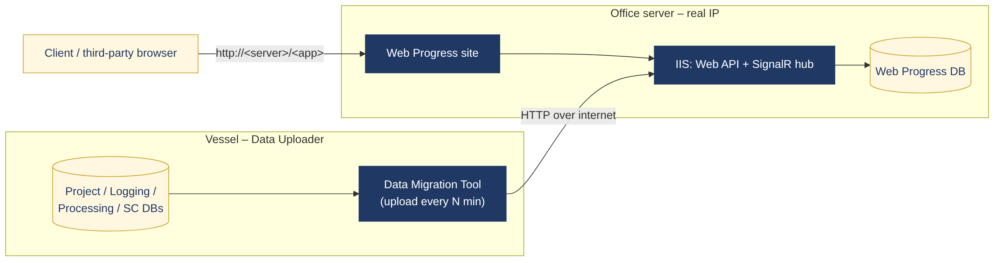

# Test Environment & Scenarios

[← Back to case study](../README.md)

## Architecture

Web Progress can be deployed in two modes:

- **On Deck.** One machine runs the site (IIS + SQL Server) and the Data Migration Tool. The installer option is *Both*.
- **Remotely (Online).** The vessel machine runs only the uploader. The office server hosts the site on a public IP, and clients view it from any browser.

## Machine roles

| Env | Role | Installer option | Purpose |
|---|---|---|---|
| ENV-01 | On Deck PC | Both | Site + DB + uploader on one machine |
| ENV-02 | Office server (real IP) | Web Server | Hosts site and DB. `envconfig.js` points the API and SignalR hub to the public address |
| ENV-03 | Vessel machine | Data Uploader | Reads local survey DBs and uploads on a timer |
| ENV-04 | Third-party viewer | none | Browser only |

**Minimum spec:** 16 GB RAM (32 GB recommended), GTX 1660-class GPU, 512 GB SSD, Intel i7, 1920×1080 display.

## Prerequisites checklist

| # | Prerequisite | Checked how |
|---|---|---|
| 1 | .NET Framework 3.5 (offline, via SXS sources) | DISM / prerequisites installer |
| 2 | IIS features: application development, HTTP, health, performance, security, management tools, IIS6 compatibility | Windows Features + verification script |
| 3 | IIS URL Rewrite module | MSI in setup package |
| 4 | .NET Framework 4.8 | Setup package |
| 5 | SQL Server with project, logging, processing and structure DBs | Restore from `.bak` (auto-detect) |
| 6 | 3D model JSON for structure scope | Placed in `<App>.Api\References` |
| 7 | Verification report: every feature `ENABLED` | PowerShell verification script |

## Scenario matrix

Each scenario is a configuration that the relevant test cases run against.

| ID | Mode | Scope | Divided pipes | KP unit | Events from | Vessels | Focus |
|---|---|---|---|---|---|---|---|
| SCN-01 | On Deck | Pipeline | No | m | Logging | 1 | Baseline install, upload, dashboards |
| SCN-02 | On Deck | Pipeline | Yes (`_`) | m | Logging | 1 | Grouping, no duplicates, first-cycle display |
| SCN-03 | On Deck | Pipeline | No | km | Logging | 1 | KP unit in km, unit change after first upload |
| SCN-04 | On Deck | Pipeline | No | m | Processing | 1 | Processing DB as source; switching source |
| SCN-05 | On Deck | Structure | — | — | — | 1 | Tasks, findings, 3D model |
| SCN-06 | On Deck | Pipeline + Structure | Yes | m | Logging | 1 | Full scope on one machine |
| SCN-07 | On Deck | Pipeline | No | m | Logging | 2 | Two vessels, overlapping primary keys, home page |
| SCN-08 | On Deck | Mixed | No | m | Logging | 2 | Vessel 1 Pipeline + SC, Vessel 2 Pipeline only |
| SCN-09 | Remotely | Pipeline | No | m | Logging | 1 | Upload to real-IP server |
| SCN-10 | Remotely | Pipeline + Structure | Yes | m | Logging | 1 | Full scope remote with 3D model |
| SCN-11 | Remotely | Pipeline + Structure | No | m | Logging | 1 | Third-party viewing by IP and alias |
| SCN-12 | Remotely | Pipeline | No | m | Logging | 1 | Network loss / server down mid-upload |
| SCN-13 | Remotely | Pipeline + Structure | No | m | Logging | 1 | Report uploaded on vessel, viewed in office |
| SCN-14 | On Deck | Pipeline | No | m | Logging | 1 | Partially logged pipe status |

The full matrix, with execution columns, is in the [test suite workbook](../test-cases/WebProgress_QA_Test_Suite.xlsx) on the *Scenario Matrix* sheet.
