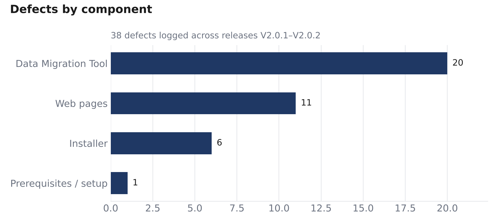
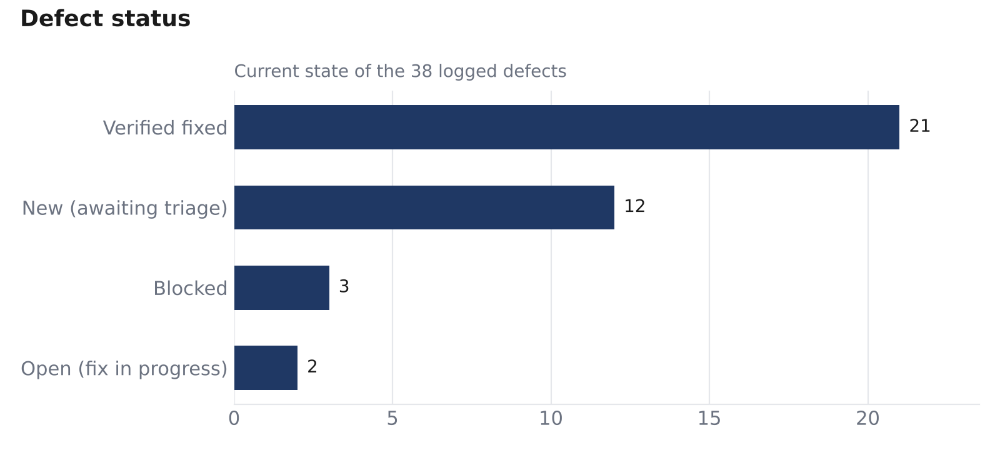

# Defect Report

[← Back to case study](../README.md)

## Metrics

| Metric | Value |
|---|---|
| Total defects logged | **38** |
| Verified fixed (Done) | **21** (55 %) |
| New, awaiting triage | 12 |
| Blocked by a design decision | 3 |
| Open (fix in progress) | 2 |
| High priority | 26 (68 %) |
| High severity | 11 |

### Release history

| Version | Released | New defects found | Fixed in release | Remaining |
|---|---|---|---|---|
| V2.0.1 | Feb 2026 | 25 | — | — |
| V2.0.2 | Apr 2026 | 8 | 20 | 5 |
| V2.0.3 | in progress | 5 so far + 6 requirements | — | — |

**Reading the data:** the Data Migration Tool has more than half the defects (20 of 38). That's where the data processing and multi-vessel logic live. It got the most regression cases and configuration scenarios as a result.

The full tracker, with dashboard and release log, is in [WebProgress_Bug_Tracker.xlsx](../bug-reports/WebProgress_Bug_Tracker.xlsx).

---

## Showcase bug reports

These eight defects show the kinds of issues I look for. They are rewritten in full report format from the tracker entries.

### bug_22 — Pipes disappear when two vessels share primary-key values
| Priority | Severity | Module | Status |
|---|---|---|---|
| High | Medium | Data Migration Tool | Fixed in V2.0.2 ✔ |

**Steps**
1. Install Web Progress.
2. Create Vessel 1 with pipes `pk_pipeid` 1–5.
3. Create Vessel 2 with pipes `pk_pipeid` 1–3.
4. Start both uploaders and open the site.

**Expected:** all pipes from both vessels are shown.
**Actual:** the first three pipes of Vessel 1 are missing. No error appears in the logs.
**Impact:** silent data loss on a multi-vessel campaign. The client sees incomplete progress, and nothing tells the operator.

### bug_38 — Partially logged pipe shown as completed
| Priority | Severity | Module | Status |
|---|---|---|---|
| High | High | Data Migration Tool | New |

**Steps**
1. Install in *Both* mode with Pipeline scope.
2. Add a 5 km pipe. Log only 2 km of data, including the start and end KP. PosLog step is 200 m.
3. Start the uploader and open Pipeline Progress.

**Expected:** the pipe shows *In Progress*, because 3 km in the middle is not logged.
**Actual:** the pipe shows *Completed*.
**Impact:** false completion reported to the client.

### bug_26 — Remote two-machine setup: no logs, no progress on the site
| Priority | Severity | Module | Status |
|---|---|---|---|
| High | High | Data Migration Tool | Fixed in V2.0.3 ✔ |

**Steps**
1. On the vessel machine, install *Data Uploader*.
2. On the server machine (real IP), install *Web Server*.
3. Enter the vessel name, connect the project DB and start the uploader.
4. Open the site from the server.

**Expected:** offshore logging data is migrated and logged, and pipeline progress appears.
**Actual:** the migration tool shows no logs and the site shows no progress.
**Impact:** the remote mode, which is the main client-facing deployment, did not work end to end. It was only found by testing the real multi-machine topology.

### bug_16 — Tool crashes when the pipes table is edited during migration
| Priority | Severity | Module | Status |
|---|---|---|---|
| High | Medium | Data Migration Tool | Fixed in V2.0.2 ✔ |

**Steps:** start a pipeline upload, then edit a pipe's start KP in the project DB.
**Expected:** the change is handled and picked up in the next cycle.
**Actual:** an unhandled exception crashes the tool.
**Impact:** surveyors edit the project DB during operations all the time, so the uploader would crash in normal use offshore.

### bug_20 — First segment duplicated for divided pipelines
| Priority | Severity | Module | Status |
|---|---|---|---|
| High | Medium | Data Migration Tool | Fixed in V2.0.2 ✔ |

**Steps:** enable *Pipeline divided into blocks*, start the uploader and review the site.
**Expected:** each pipe part appears once.
**Actual:** the first segment of every pipe appears twice, which inflates the KP totals.

### bug_9 — Tool reloads the last data without asking
| Priority | Severity | Module | Status |
|---|---|---|---|
| High | High | Data Migration Tool – Save Profile | Fixed in V2.0.2 ✔ |

**Steps:** fill in the settings, save a profile, close the tool, reopen it.
**Expected:** the tool opens blank or asks which profile to load.
**Actual:** the last data is loaded silently.
**Impact:** an operator handling several vessels could upload to the wrong vessel without noticing.

### bug_3 — Site URL fails with `localhost`
| Priority | Severity | Module | Status |
|---|---|---|---|
| High | High | Installer | Fixed in V2.0.2 ✔ |

**Steps:** install in *Both* mode, open IIS and browse the site.
**Expected:** the site works with both `localhost` and the machine IP.
**Actual:** it only works after manually replacing `localhost` with the IP.

### bug_37 — Report uploaded on the vessel cannot be opened in the office
| Priority | Severity | Module | Status |
|---|---|---|---|
| High | Medium | Web site – Reports | New |

**Steps:** in remote mode, add a DPR report with a PDF on the vessel machine, then open the Reports page from the office.
**Expected:** the PDF is uploaded to the office server with the report record, and anyone can open it once it is approved.
**Actual:** the report appears in the list, but the PDF stays on the vessel, so office users cannot open it.
